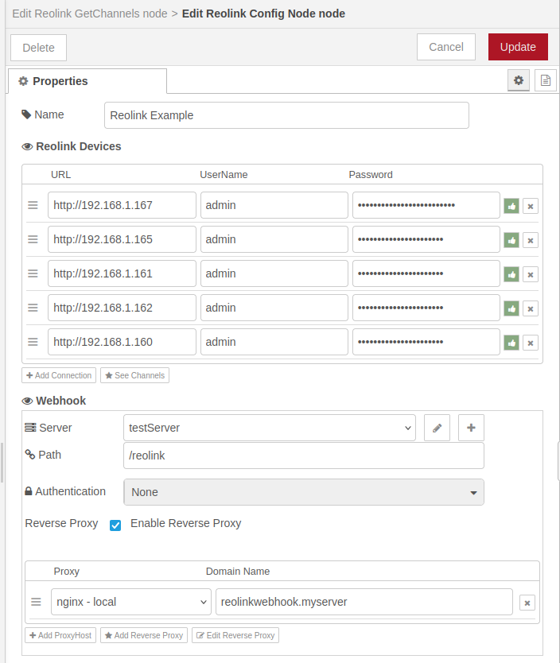
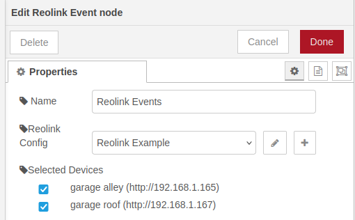
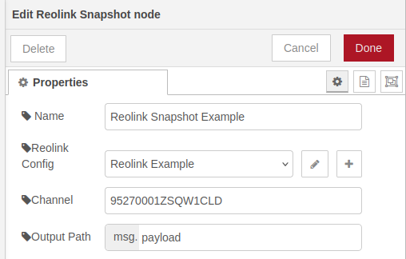
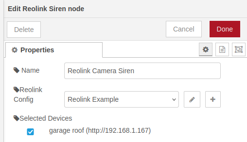
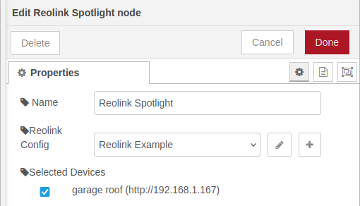
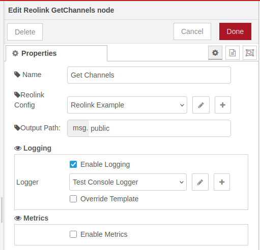

# @theotherwillembotha/node-red-reolink

A Node-RED plugin for integrating with Reolink IP cameras and NVRs. Supports snapshot capture, siren and spotlight control, and real-time motion/alarm event delivery via webhooks.

> [!IMPORTANT]
> **This plugin requires [`@theotherwillembotha/node-red-plugincore`](https://github.com/theotherwillembotha/nodered_plugincore) to be installed.**
>
> `node-red-plugincore` is declared as a dependency and npm will install it automatically alongside this package. However, due to a [known Node-RED limitation](https://github.com/node-red/node-red/issues/3529), packages that arrive as transitive npm dependencies are only discovered by the Node-RED runtime on the **next startup**.
>
> **You have two options:**
> - Install [`@theotherwillembotha/node-red-plugincore`](https://flows.nodered.org/node/@theotherwillembotha/node-red-plugincore) via the palette manager or `npm install` **first**, then install this plugin — both will be available immediately without a restart.
> - Install this plugin directly — `node-red-plugincore` will be installed automatically alongside it. **Restart Node-RED** once and both packages will be fully loaded.

---

## Prerequisites

- Node-RED >= 4.0.0
- One or more Reolink devices reachable from the Node-RED host over HTTP
- For real-time events: a **Webhook Server** config node (`@theotherwillembotha/node-red-plugincore`) and a publicly reachable endpoint (e.g. via [Nginx Proxy Manager](https://www.npmjs.com/package/@theotherwillembotha/node-red-nginxproxymanager))

---

## Installation

```bash
npm install @theotherwillembotha/node-red-reolink
```

---

## Nodes

### Reolink Config Node

Shared configuration node. All Reolink nodes that operate against the same set of cameras must reference the same config node.

Add one entry per device (IPC or NVR). Each entry requires a URL (e.g. `http://192.168.0.100`), a username, and a password. Use the test button on each row to verify connectivity before saving.

Click **See Channels** to view the unified channel map across all connected devices, including per-device capability flags (`sirenSupport`, `webhookSupport`, `ledLightSupport`).

If webhook-based events are needed, configure a Webhook Server and optionally a reverse proxy so that the camera can reach the Node-RED instance.



---

### Reolink Event Node

Receives real-time motion and alarm events pushed from the camera via webhook. Only cameras that report `webhookSupport` in the channel view will deliver events.

**Input:** none — triggered by the camera
**Output:** the event payload pushed by the camera



---

### Reolink Snapshot Node

Captures a still image from a specific camera channel when triggered by an incoming message.

**Input:** any message (used as a trigger)
**Output:** the input message with the image `Buffer` placed at the configured output path (default: `msg.payload`)

Use the **Get Channels** node to find the UID of the channel you want to snapshot.



---

### Reolink Siren Node

Activates or deactivates the siren on cameras that support it (`sirenSupport`). The siren runs in manual mode and will sound until explicitly stopped.

**Input:**
- `msg.on` — `true` to activate, `false` to stop
- `msg.device` *(optional)* — URL of a specific device to target; overrides the configured selection

**Output:** the input message, passed through unchanged



---

### Reolink Spotlight Node

Controls the LED spotlight (white light) on cameras that support it (`ledLightSupport`).

**Input:**
- `msg.on` — `true` to switch on, `false` to switch off
- `msg.device` *(optional)* — URL of a specific device to target; overrides the configured selection

No output port.



---

### Reolink Get Channels Node

Returns a map of all available channels across the connected Reolink devices. Useful for discovering channel UIDs and checking per-device capability flags.

**Input:** any message (used as a trigger)
**Output:** the input message with the channel map inserted at the configured output path (default: `msg.payload`)



Example output:

```json
{
  "12345678ZT22ZABC": {
    "uid": "12345678ZT22ZABC",
    "name": "front patio",
    "devices": [
      {
        "deviceURL": "http://192.168.0.124",
        "channel": 0,
        "abilities": {
          "sirenSupport": false,
          "webhookSupport": false,
          "ledLightSupport": false
        }
      }
    ]
  }
}
```

---

## Notes

- A standalone IPC appears as a single channel. An NVR exposes each connected camera as a separate channel.
- If both an IPC and the NVR it is connected to are added to the config node, that camera's channel will appear with two device entries — one for the IPC directly and one via the NVR.
- Capability flags are per-device, not per-channel. The NVR and the connected IPC may report different capabilities for the same physical camera.
- Reolink devices must be reachable from the Node-RED host over HTTP. HTTPS is not yet supported.

---

## License

ISC
